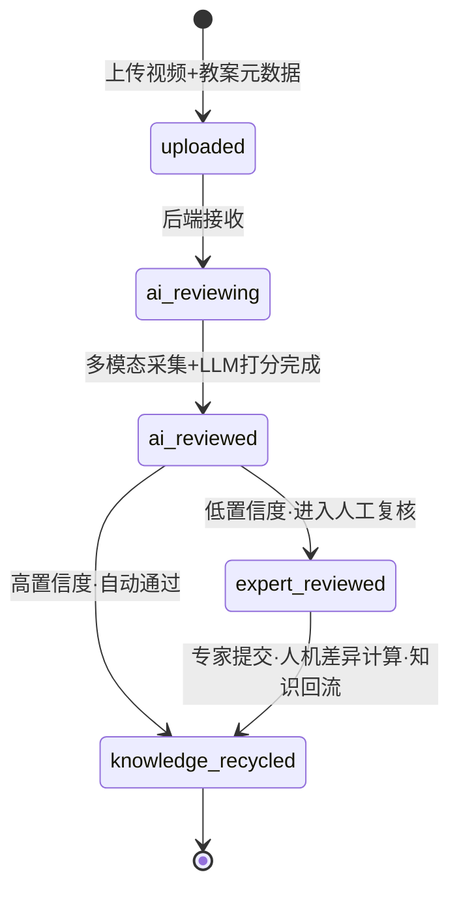

# 前端可视化组件开发规格（v1.0）

> 所属阶段：前端全链路可视化改造（计划书 M1 里程碑）
> 编制日期：2026-10-28｜编制人：杨德琰（项目 Owner）
> 定位：把四个核心可视化组件（PipelineFlow / EvidenceTimeline / ScoreCharts / ChatPanel）从"要做什么"细化成"接口契约 + 类型定义 + 伪代码 + 验收标准"，可直接用于编码。所有字段与后端 Agent 结构化 JSON（《Agent_SystemPrompt与输出模板_v1.0》）和《标准化评价指标体系_v1.0》严格对齐。

---

## 0. 数据契约基础（四个组件的公共依赖）

### 0.1 review_status 状态机

全链路状态机，前端 PipelineFlow 直接消费；后端驱动迁移，前端只读轮询。

```
uploaded ──上传完成──▶ ai_reviewing ──机器初评完成──▶ ai_reviewed
                                                        │
                            ┌─────────────┬─────────────┘
                            ▼                             ▼
                     expert_reviewed               knowledge_recycled(自动通过)
                            │
                            ▼
                    knowledge_recycled(人工复核通过)
```



**回流口径**：`expert_reviewed → knowledge_recycled` 由专家提交复评（`POST /api/expert-review`）触发——提交后计算人机差异并**精选回流**：仅当总分差 ≥ 8 或某维度差 ≥ 2、且专家填写了校正意见时，将争议课例（脱敏）回流入知识库 `doc_type=case`；未达门槛只进校准数据（`evaluation + expert_review` 表），不回流。实现见 `backend/app/rag/recycle.py`。

**TS 枚举**：

```ts
export type ReviewStatus =
  | 'uploaded'
  | 'ai_reviewing'
  | 'ai_reviewed'        // 机器初评完成，待决策
  | 'expert_reviewed'    // 专家复核完成
  | 'knowledge_recycled' // 知识库回流完成
```

### 0.2 Agent 结构化输出 → 前端字段映射

后端评价报告 JSON 与前端组件字段一一对应：

| 后端字段 | 类型 | 前端消费组件 | 说明 |
|---|---|---|---|
| `meta` | object | 报告头 | 用户/试讲/学科/课题/时长等元信息 |
| `scores` | object | ScoreCharts | D1–D4 维度 + overall_percent |
| `timeline_feedback` | array | EvidenceTimeline | 带起止时间戳的分段评语 |
| `weaknesses` | string[] | 报告"短板清单" | 直接渲染为清单 |
| `progress_compare` | object | ScoreCharts（成长） | 趋势 + 维度增量 + 仍薄弱 |
| `training_plan` | object | 报告"训练建议"卡片 | next_focus / specific_tasks / reference_case |
| `disclaimer` | string | 报告固定免责条 | 固定置于报告开头 |

**TS 类型（建议放 `src/shared/types/agent.ts`）**：

```ts
export interface AgentReport {
  meta: {
    user_id: string; try_id: string; subject: string; lesson: string;
    lesson_type: string; grade_level: string;
    duration_seconds: number; recorded_at: string; // ISO8601
  };
  disclaimer: string;
  scores: {
    D1_teaching_design: DimensionScore; // weight 0.25
    D2_language:          DimensionScore; // weight 0.30
    D3_blackboard:        DimensionScore; // weight 0.20
    D4_presence:          DimensionScore; // weight 0.25
    overall_percent: number;
  };
  timeline_feedback: TimelineFeedback[];
  weaknesses: string[];
  progress_compare: {
    vs_previous_try_id: string;
    trend: 'improved' | 'declined' | 'flat' | 'first_try';
    dimension_deltas: { D1: number; D2: number; D3: number; D4: number };
    still_weak: string[];
  };
  training_plan: {
    next_focus: string; specific_tasks: string[];
    reference_case: string; estimated_repeat_times: number;
  };
}

export interface DimensionScore {
  total: number; weight: number; items: Record<string, number>; // 如 { "D1.1": 4 }
}

export interface TimelineFeedback {
  timestamp_start: string; // "mm:ss"
  timestamp_end: string;   // "mm:ss"
  segment: string;         // 导入/新授/练习/小结
  issue: string;
  suggestion: string;
}
```

### 0.3 本规格依赖的 REST 接口（FastAPI 侧，供前端联调）

> 前端经 Vite 代理 `/proxy-default` → 后端 `127.0.0.1:8000`，统一以 `/proxy-default/api/...` 调用。
> 下表为**后端实际实现 + 前端已接通**的真实接口；"规划"行表示后端暂未提供，属后续演进。

**认证**
| 接口 | 方法 | 用途 | 消费方 |
|---|---|---|---|
| `/api/auth/login` | POST | 登录（body: username/password）→ `{token, user}` | 登录页（`service/api/auth.ts`） |
| `/api/auth/me` | GET | 登录态恢复（Bearer token）→ `{user}` | auth store（`service/api/auth.ts`） |

**试讲 / 评价**
| 接口 | 方法 | 用途 | 消费方 |
|---|---|---|---|
| `/api/evaluate` | POST | 提交一次试讲（meta + 多模态信号）→ 完整评价报告 | 学生端评价页 |
| `/api/evaluate_video` | POST | 上传视频 + 教案元数据（multipart）→ 报告 | 学生端上传/评价页 |
| `/api/try/{try_id}` | GET | 单次试讲完整报告（AgentReport） | 报告详情 / ScoreCharts / 教师复核左栏 |
| `/api/users/{user_id}/history` | GET | 用户试讲历史（?limit=） | 首页 / 学生工作台 |
| `/api/users/{user_id}/growth` | GET | 成长轨迹 | 成长页 / 工作台 / 评价页 |
| `/api/dashboard/class` | GET | 班级概览统计 | 教师首页 / 教师工作台 |

**专家 / 教师端**
| 接口 | 方法 | 用途 | 消费方 |
|---|---|---|---|
| `/api/triage/pending` | GET | 待复评列表（?expert_id= 可选，为空=admin 公共池） | 教师待复评列表 |
| `/api/expert-review` | POST | 提交复评（body: try_id/expert_id/final_scores/comments）→ 算人机差异 → 通知 → 精选回流 | 教师复评表单 |
| `/api/users` | GET | 账号列表（?role= 可选） | admin 管理（后端已实现） |
| `/api/relationships` | POST | 建立师生指导关系 | admin 管理（后端已实现） |

**消息**
| 接口 | 方法 | 用途 | 消费方 |
|---|---|---|---|
| `/api/messages` | GET | 消息列表（?user_id=） | 学生端消息铃铛 |
| `/api/messages/read` | POST | 标记已读 | 消息铃铛 |

**知识库管理**
| 接口 | 方法 | 用途 | 消费方 |
|---|---|---|---|
| `/api/kb/documents` | GET | 已入库文档列表（Chroma 聚合） | 知识库管理页 |
| `/api/kb/search` | POST | 检索（body: query/top_k） | 知识库检索 |
| `/api/kb/upload` | POST | 上传文件到待入库目录（仅保存，不自动入库） | 知识库上传 |
| `/api/kb/uploads` | GET | 待入库文件列表（含类型/学科/是否已入库） | 知识库管理页 |
| `/api/kb/index` | POST | 增量入库（待入库目录 → 向量库） | 知识库"入库"按钮 |
| `/api/kb/uploads/{filename}` | DELETE | 撤销上传（未入库文件） | 知识库管理页 |
| `/api/kb/documents/{source_file}` | DELETE | 删除指定文档 | 知识库管理页 |

**校准 / 对话 / 运维**
| 接口 | 方法 | 用途 | 消费方 |
|---|---|---|---|
| `/api/calibration` | GET | 机器分 vs 专家分偏差（校准状态） | 系统校准（后端已实现） |
| `/api/chat` | POST | 试讲陪练对话（body: user_id/message/session_id；**非流式**） | 学生端 chat 页 |
| `/api/chat/sessions` | GET | 会话列表（按 session 聚合：标题/意图/起止时间/消息数，供主题分类+时间查找） | 学生端 chat 页 |
| `/api/chat/sessions/{session_id}` | GET | 会话完整对话（时间正序，回看） | 学生端 chat 页 |
| `/api/expert-chat` | POST | 专家端教研助手 | 教师教研助手（后端已实现） |
| `/api/traces` | GET | 轨迹日志列表 | 首页 / 运维 |
| `/health` | GET | 健康检查 | 运维 |

**规划（后端暂未提供）**
| 接口 | 方法 | 规划用途 |
|---|---|---|
| `/api/try/upload` | POST | 上传视频 + 元数据（现由 `/api/evaluate_video` 承担） |
| `/api/try/{try_id}/pipeline` | GET | 全链路节点状态（现按 review_status 轮询或演示数据代替） |
| `/api/chat/stream` / `/api/chat/ws` | SSE/WS | 流式对话（现后端 `/api/chat` 为非流式） |

---

## 1. PipelineFlow —— 全链路 DAG 可视化（AntV X6）

### 1.1 组件 API

```ts
export type PipelineStage =
  | 'upload' | 'collect' | 'ai_review' | 'expert_review' | 'recycle' | 'training';

export type NodeStatus = 'pending' | 'processing' | 'done' | 'error';

export interface PipelineNode {
  id: string;
  stage: PipelineStage;
  label: string;
  status: NodeStatus;
  detail?: {
    title: string;         // 阶段产出标题
    summary: string;       // 摘要文本
    metrics?: { label: string; value: string }[]; // 可选指标
  };
  timestamp?: string;      // 完成时间
}

export interface PipelineFlowProps {
  tryId: string;
  nodes: PipelineNode[];
  edges: { source: string; target: string }[];
  currentStatus: ReviewStatus;
  onNodeClick?: (node: PipelineNode) => void;
  pollIntervalMs?: number;   // 默认 3000
  autoPoll?: boolean;        // 默认 true
}
```

### 1.2 状态映射规则（review_status → 节点着色）

| review_status | upload | collect | ai_review | expert_review | recycle | training |
|---|---|---|---|---|---|---|
| uploaded | done | pending | pending | pending | pending | pending |
| ai_reviewing | done | processing | processing | pending | pending | pending |
| ai_reviewed（待复核） | done | done | done | pending | pending | pending |
| ai_reviewed（自动通过） | done | done | done | —（跳过，虚线） | processing | pending |
| expert_reviewed | done | done | done | done | pending | pending |
| knowledge_recycled | done | done | done | done/跳过 | done | done |

- 颜色：done=绿（#2E7D32）、processing=蓝并加 loading 动画、error=红（#C62828）、pending=灰（#BDBDBD）、跳过节点用虚线灰。
- 初始静态状态即可读懂主链路；交互仅在"点击节点→右侧面板展示 detail"时使用。

### 1.3 核心伪代码

```
function PipelineFlow(props):
  渲染 X6 画布，nodes→X6 节点（含状态色/loading），edges→X6 连线
  调用 mapStatus(currentStatus) 计算每个 stage 的 status，更新节点样式

  if autoPoll:
    interval = setInterval(pollIntervalMs, 轮询):
      res = GET /api/try/{tryId}/pipeline  # 后端暂未实现；现以 review_status 轮询或演示数据代替
      if res.currentStatus != props.currentStatus:
        更新 props.currentStatus，重新 mapStatus
      nodes.forEach(n => 用 res.nodes 同步 status/timestamp)
      若全部 done 或 error → clearInterval

  onNodeClick(node):
    if node.detail: 右侧面板渲染 detail（title/summary/metrics）
    emit onNodeClick(node)
```

### 1.4 验收标准

- [ ] 六类状态（pending/processing/done/error/跳过/loading）渲染正确且无重叠
- [ ] 状态变化在轮询间隔内自动刷新，不整页跳转
- [ ] 点击节点弹出产出摘要，窄屏不溢出
- [ ] 异常节点可见可点击，可定位到后端日志链接（预留）

---

## 2. EvidenceTimeline —— 视频证据时间轴（video.js + 自研标记）

> 本项目可视化价值最直观的载体，也是最大技术风险点，M1 优先攻坚。

### 2.1 组件 API

```ts
export interface TimelineMarker {
  id: string;
  startSec: number;
  endSec?: number;
  segment?: string;     // 导入/新授/练习/小结
  issue?: string;       // 问题描述
  suggestion?: string;  // 改进建议
  source: 'ai' | 'expert';
  diverged?: boolean;   // 专家标注：与机器判断分歧
}

export interface EvidenceTimelineProps {
  videoUrl: string;
  markers: TimelineMarker[];
  mode: 'readonly' | 'review';   // 学生只读 / 专家可标注分歧
  onSeek?: (sec: number) => void;                    // 点击标记→跳转
  onMarkerClick?: (m: TimelineMarker) => void;       // 选中评语卡片
  onDivergenceChange?: (m: TimelineMarker, diverged: boolean) => void; // 专家标注
}
```

### 2.2 数据来源映射

- 学生端报告页：`markers` 直接来自 `AgentReport.timeline_feedback`（source='ai'），时间戳 `mm:ss` 转秒。
- 专家复评页：左侧机器摘要 + 中间时间轴（source='ai'），专家在右侧标注分歧后 `diverged=true`、可新增 source='expert' 的标记。

**时间戳转换**：`mm:ss` → 秒 = `parseInt(mm)*60 + parseInt(ss)`；渲染回读时补零。

### 2.3 实现要点

- 播放器：`video.js`（成熟、兼容性好），进度条叠加自研标记层，不依赖 `videojs-markers` 插件（该插件较旧、可维护性差），改为在 `videojs` 自定义组件或外层 DOM 同步定位。
- 双向联动：点击进度条标记 → `player.currentTime(sec)` + 高亮对应评语卡片；点击评语卡片 → 跳转 + 进度条标记高亮。
- 专家模式额外支持在时间轴某点"标注分歧"（`diverged=true`），分歧标记用琥珀色（#C8861A）区分。

### 2.4 核心伪代码

```
function EvidenceTimeline(props):
  player = videojs(el, { sources:[{src:videoUrl,type:guessType(videoUrl)}] })
  markersLayer = 在进度条容器上方叠一层 marker 定位层（按 duration 缩放坐标）

  renderMarkers():
    markersLayer.clear()
    for m in props.markers:
      x = (m.startSec / player.duration()) * 100%
      markerEl = createMarker(m, x)   // 颜色按 source/diverged
      markerEl.onclick => onSeekTo(m)
    if props.mode == 'review':
      每个 marker 提供"标注分歧"开关 => onDivergenceChange(m, val)

  onSeekTo(m):
    player.currentTime(m.startSec)
    highlight(m.id); emit onSeek(m.startSec); emit onMarkerClick(m)

  onTimeUpdate():
    cur = player.currentTime()
    高亮当前处于 [startSec,endSec] 区间内的 marker；滚动对应评语卡片进入视图

  // 兼容性处理：不同视频编码/时长加载失败时，兜底为"分段评语卡片 + 时间戳文本跳转"
  player.on('error', () => 降级为非时间轴模式，仍可点击"跳至 mm:ss")
```

### 2.5 验收标准

- [ ] 进度条标记按时间戳正确定位、可点击跳转，反向卡片点击可定位
- [ ] 播放到某段时对应评语卡片自动高亮
- [ ] 专家模式可标注分歧，分歧标记颜色区分
- [ ] 视频加载失败时降级模式可用（不缺失功能）
- [ ] 移动端触控目标 ≥ 44px，时间轴可横滚

---

## 3. ScoreCharts —— 评分与成长可视化（ECharts）

> 严格满足"高信息密度 + 强制数据标签 + 清晰图例 + 可直用于演示"的要求。

### 3.1 组件 API

```ts
export interface DimensionScoreView {
  id: 'D1' | 'D2' | 'D3' | 'D4';
  name: string;              // 教学设计合理性/讲授语言/板书规范/教姿教态
  total: number;             // 0-5 维度分
  weight: number;            // 0.25/0.30/0.20/0.25
  items: { key: string; score: number }[]; // 二级指标
}

export interface ScoreChartsProps {
  current: DimensionScoreView[];             // 4 维（雷达）
  overallPercent: number;                    // 百分制总分
  previous?: DimensionScoreView[];           // 叠加对比（雷达）
  history?: {
    tryId: string; overallPercent: number;
    reviewed: boolean; recordedAt: string;
  }[];                                       // 成长曲线（折线）
  showLabels?: boolean;                      // 默认 true
}
```

### 3.2 雷达图（四维度）

- 指标：D1–D4（各维度 `total`，0–5 制）。
- 当前试讲：主色藏青实线；上次试讲（`previous`）：同色系虚线叠加对比，图例标注"本次/上次"。
- 必须显示：每个顶点数值标签、图例、维度名；辅助说明维度权重（如括号标注 25%）。

```ts
// 示意 option（data 需按 props 实算，weight 来自后端）
option = {
  radar: { indicator: [
    { name: 'D1 教学设计(25%)', max: 5 },
    { name: 'D2 语言表达(30%)', max: 5 },
    { name: 'D3 板书规范(20%)', max: 5 },
    { name: 'D4 教姿教态(25%)', max: 5 },
  ]},
  series: [{ type: 'radar', data: [
    { value: [d1,d2,d3,d4], name: '本次', itemStyle:{color:'#1A2B4A'}, label:{show:true} },
    { value: [p1,p2,p3,p4], name: '上次', itemStyle:{color:'#C8861A',type:'dashed'} },
  ]}],
  legend: { bottom: 0 }
};
```

### 3.3 成长曲线（折线图）

- X：试讲次数/日期（按 recorded_at 排序）；Y：overall_percent。
- 用机器分绘制趋势线；`reviewed=true` 的点加"专家复评"小标记（形状/颜色区分）。
- 强制数据标签（显示分数）、清晰图例；可用自定义参考线（如"良好 80 分"基准线）。

### 3.4 验收标准

- [ ] 雷达图四维数值标签、图例、权重标注齐全，无遮挡碰撞
- [ ] 成长曲线带数据标签、专家复评点标记、参考基准线，可直用于演示
- [ ] 数据全部来自后端（current/previous/history），无本地伪造
- [ ] 窄屏下图表缩放不截断，图例不遮挡数据

---

## 4. ChatPanel —— 流式对话面板（SSE/WebSocket）

> 接入 Agent 推理流；支持以试讲/评语/时间轴片段为上下文锚点。

### 4.1 组件 API

```ts
export interface ChatMessage {
  id: string;
  role: 'user' | 'assistant' | 'system';
  content: string;
  ts: number;
  meta?: {
    source?: 'report' | 'timeline' | 'score' | 'weakness';
    tryId?: string;
    markerId?: string;   // 关联时间轴片段
    step?: string;       // Agent 推理步骤（ReAct/Reflexion）名
  };
}

export interface ContextAnchor {
  type: 'try' | 'timeline' | 'score' | 'weakness';
  tryId?: string;
  markerId?: string;
  text: string;          // 锚点描述（如"第 1 段：导入环节，语速过快"）
}

export interface ChatPanelProps {
  anchors: ContextAnchor[];      // 可引用上下文
  transport?: 'sse' | 'ws';      // 默认 ws（Agent 需返回推理步骤）
  history?: ChatMessage[];
  onStreamMessage?: (partial: string) => void;
  onAgentStep?: (step: string) => void;  // 展示 Agent 正在做什么
}
```

### 4.2 传输与解析

- **当前实现**：后端 `/api/chat` 为**非流式**（POST，body 传 `user_id/message/session_id`，返回 `{status, reply, session_id}`）；已建独立**学生端 chat 页**（`/student/chat`）：左会话列表按**主题分类**（查成绩/怎么练/模拟陪练/状态调整/随便聊聊，取自首条消息 intent）+ **时间筛选**（全部/今天/近7天/更早），右对话窗口支持新建/延续，点历史会话回看完整对话（每条消息带时间戳）。配套 `/api/chat/sessions`（列表）与 `/api/chat/sessions/{session_id}`（详情）。
- **规划演进**：如需流式返回"推理步骤 + 最终回复"，再引入 WebSocket（`/api/chat/ws`）或 SSE（`/api/chat/stream`）——后端当前未实现，需另行排期。

**WebSocket 消息协议（建议）**：

```jsonc
// 客户端→服务端
{ "type": "chat", "anchors": [{...}], "message": "板书这块怎么改" }
// 服务端→客户端（分帧）
{ "type": "step",   "step": "检索课标与评课量表" }        // Agent 正在做什么
{ "type": "delta",  "content": "建议从" }                 // 增量文本
{ "type": "delta",  "content": "正楷入手……" }
{ "type": "done",   "message_id": "m_123" }
// 异常
{ "type": "error",  "code": "AGENT_TIMEOUT", "message": "..." }
```

**SSE 解析伪代码**：

```
function streamChat(sseUrl, payload, handlers):
  es = new EventSource-like (fetch + ReadableStream 或原生 SSE)
  buffer = ''
  onChunk(chunk):
    buffer += chunk
    while buffer 含 "\n\n":
      解析一行 "data: {...}"
      switch ev.type:
        'step'  => handlers.onAgentStep(ev.step)
        'delta' => handlers.onStreamMessage(delta)，追加到当前 assistant 消息
        'done'  => 结束，标记消息完成
        'error' => handlers.error
```

### 4.3 上下文锚点

- 从报告页/时间轴点"带入对话"：`anchors` 携带 tryId + markerId + 描述文本。
- 发送时把 anchors 序列化进消息 payload；服务端据此检索对应时间轴片段/评语做上下文。

### 4.4 验收标准

- [ ] 流式打字机输出平滑，可中断、可重发
- [ ] Agent 推理步骤（step）在面板上方实时展示
- [ ] 可从时间轴/评语"带入对话"，服务端能识别锚点上下文
- [ ] 多轮历史可持久化（localStorage/后端），刷新后恢复
- [ ] 网络异常/Agent 超时有明确错误提示，不卡死

---

## 5. 组件接入 Soybean 与集成顺序

1. `src/shared/types/agent.ts` 落公共类型（0.2），四个组件统一引用，杜绝字段漂移。
2. 按依赖顺序开发：**EvidenceTimeline（最大风险，先行）→ PipelineFlow → ScoreCharts → ChatPanel**。
3. 演示数据先行：在 M1 用一份 `AgentReport` mock JSON + 一段示例视频驱动四个组件，不等后端，缩短关键路径。
4. 双区复用：学生报告页用 EvidenceTimeline(readonly)+ScoreCharts；专家复评页用 EvidenceTimeline(review)+PipelineFlow；对话面板两区通用。

## 6. 验收总纲（M1 完成标准）

- [ ] 四个组件在演示数据下完整可用，双区均可接入
- [ ] 所有类型与后端 Agent JSON 对齐，无手工映射断层
- [ ] 图表均带标签/图例/基准线，可直接用于现场演示
- [ ] EvidenceTimeline 视频失败降级路径可用
- [ ] 通过一次真实试讲数据全链路走通（联调前以 mock 代替）

> 版本：v1.0（M1 开发规格基线）｜下版触发：M1 组件实现后按评审与实测调整。
