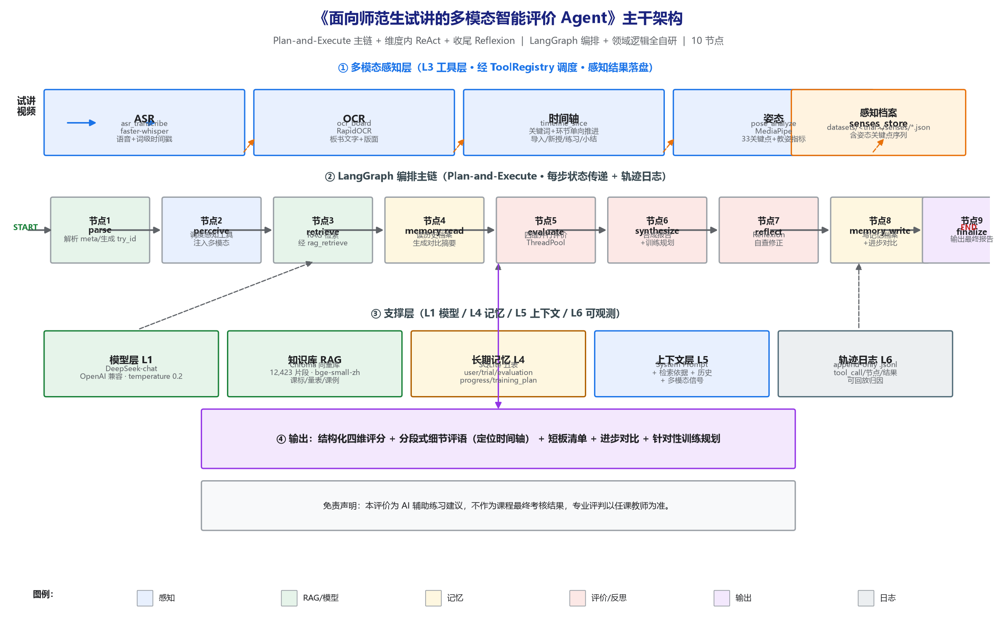
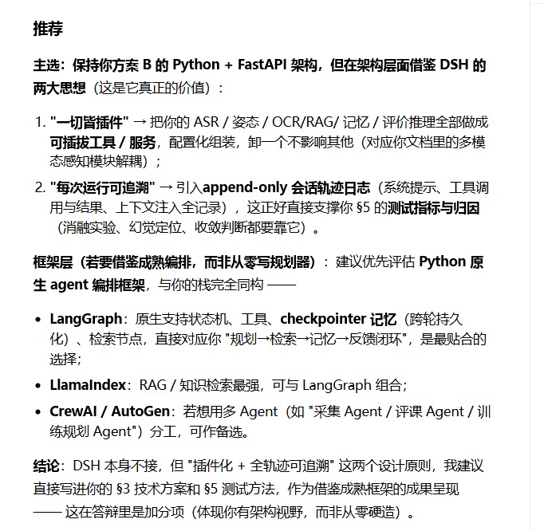
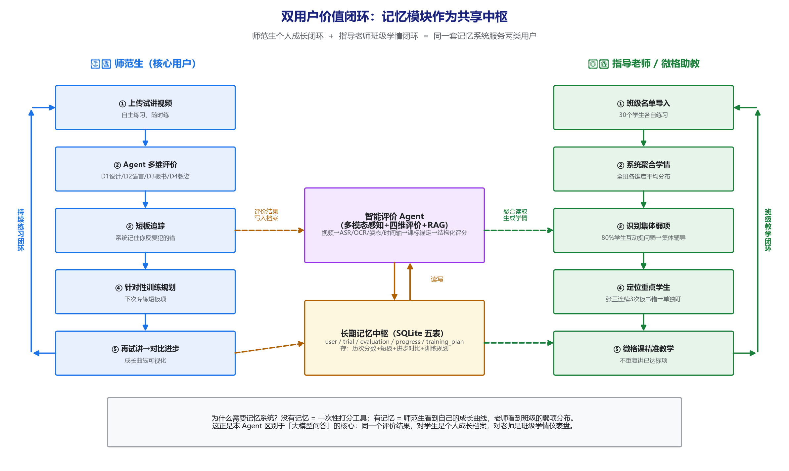
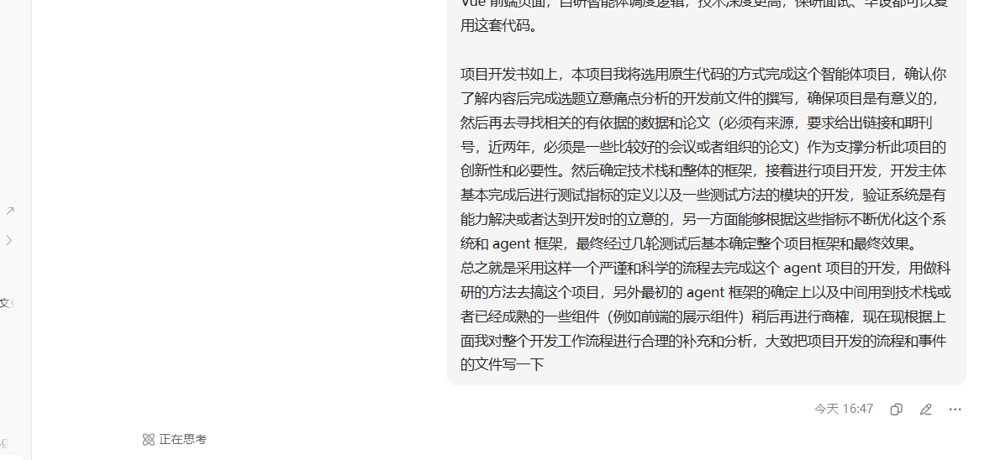

# 智能体主干架构说明

> 所属项目：《面向师范生试讲的多模态智能评价 Agent》（教育智能体设计大赛·教学赋能赛道，原生代码方案B）
> 文档定位：面向评委/答辩/协作者的**实现级架构说明**。从"六层技术栈"视角把代码骨架讲清楚——每一条都与 `backend/app/` 下的源码一一对应，避免"结构说不清、自研框架是否有合理性"的质疑。
> 编制：杨德琰　|　版本：v1.0（阶段3 完成后编写，与当前代码一致）　|　日期：2026-10-25

---

## 0. 一张图看懂整体架构



*（图 0-1 自绘主干架构图：①多模态感知层 → ②LangGraph 编排主链（10 节点）→ ③支撑层（模型/知识库/记忆/上下文/轨迹）→ ④输出。图片源码见 `backend/app/scripts/_draw_arch.py`，可复现。）*

本 Agent 的核心范式是 **Plan-and-Execute 主链 + 维度内 ReAct + 收尾 Reflexion**：主链固定 10 个节点顺序推进（保证评价流程稳定、可解释），节点内部按需调用工具与检索（动态、可探索），评价完成后做一次自我反思（纠错闭环）。编排交 LangGraph，领域逻辑（评价/记忆/反思/检索）全部自研——这正是方案B"自研框架合理性"的落点：**框架负责状态流转与循环，业务专家逻辑由自己实现，不黑盒**。

---

## 1. 技术栈总览（与六层技术栈对齐）

| 层级 | 选型 | 说明 |
|---|---|---|
| L1 模型与推理 | DeepSeek-chat（OpenAI 兼容 SDK） | 基座推理模型，temperature 0.2 保证评价稳定 |
| L2 框架与运行时 | **LangGraph**（StateGraph + State） | 编排 10 节点状态机，状态传递、分支、并行 |
| L3 工具与协议 | **自研 ToolRegistry** + Function Calling | 四类感知工具 + RAG 检索工具，可插拔；MCP 作答辩可选项 |
| L4 记忆层 | SQLite 五表（memory_store）+ 感知档案（senses_store） | 跨会话长期记忆 + 多模态原始感知档案 |
| L5 上下文层 | SystemPrompt + 检索依据 + 历史 + 多模态信号 | 防上下文漂移（见 §5） |
| L6 可观测性 | append-only 轨迹日志（trace_logger） | 每次运行全记录，可回放、可归因、支撑测试 |

> 为什么用 LangGraph 而非 DeepSeek Harness 本体：DSH 是通用多智能体脚手架，其价值在"**一切皆插件**"与"**每次运行可追溯**"两大设计思想——我们**取其思想、弃其本体**，用 LangGraph（状态机原生支持）承载这两大思想，业务逻辑全自研。下图为当时选型决策的原始论证。



*（图 1-1 技术框架选型论证：主选方案B的 Python+FastAPI 架构，借鉴 DSH 的"插件化 + 全轨迹可追溯"两大思想；框架层优先 LangGraph。图片来源：项目立项讨论截图。）*

---

## 2. 代码结构（backend/app/，按职责分层）

```
backend/app/
├── config/settings.py        # 全局配置：路径/LLM/四维权重/指标/免责声明
├── llm/llm_client.py         # L1+L5：LLM 客户端、System/User Prompt 构建、JSON 解析
├── rag/retriever.py          # L3：RAG 检索（复用阶段1 向量库）
├── memory/memory_store.py    # L4：SQLite 五表长期记忆 + 跨轮次进步对比
├── evaluator/evaluator.py    # 领域逻辑：四维并行评价 + 合成 + Reflexion
├── trace/trace_logger.py     # L6：append-only 轨迹日志
├── graph/
│   ├── state.py              # AgentState（TypedDict，节点间传递的状态契约）
│   └── graph.py              # L2：10 节点 StateGraph 组装 + run_agent 入口
├── tools/                    # L3：工具层（阶段3 核心）
│   ├── registry.py           # ToolRegistry：register/unregister/list/call + 钩子
│   ├── agent_tools.py        # rag_retrieve 工具
│   ├── perception_tools.py   # asr_transcribe + ocr_board
│   ├── timeline_tool.py      # timeline_slice
│   ├── pose_tool.py          # pose_analyze（MediaPipe）
│   ├── perceive.py           # 感知调度器：一条视频→四类工具→多模态信号+落盘
│   └── senses_store.py       # 感知档案落盘/读取
└── main.py                   # FastAPI：evaluate/history/traces/health + 前端挂载
```

---

## 3. 多模态感知层（L3 工具层 · 阶段3）

### 3.1 设计原则：先验证后封装

每个感知工具都先基于**真实试讲视频**（`datasets/demo_preteaching/video/mypreteaching_fore.mp4`，"一次函数"3 分钟）实测通过，才固化为可插拔工具。这保证"封装出来的工具一定可用"，避免返工。

### 3.2 四类感知工具（全部经 ToolRegistry 调度）

| 工具 | 技术 | 提取信号 | 服务维度 | 真实结果 |
|---|---|---|---|---|
| `asr_transcribe` | faster-whisper 1.2.1（small/int8/CPU） | 语音文本 + 词级时间戳 + 语速/口头禅/停顿 | D1、D2 | 365字/50段/322词时间戳，wpm=105 |
| `ocr_board` | ffmpeg 抽帧 + RapidOCR | 板书文字 + 检测框 + 版面 | D3 | 识别"一次函数 y=kx+b 斜率截距"等 |
| `timeline_slice` | 关键词规则 + 环节单向推进约束 | 导入/新授/练习/小结时间轴 | D1 | 4 环节，与视频内容吻合 |
| `pose_analyze` | MediaPipe 1.1.1 新版 tasks API | 33 关键点序列 + 手势/倾斜/面向/举手 | D4 | 19/20 帧检测，手势均值 4.24 |

### 3.3 工具注册表（可插拔，回应"自研框架合理性"）

```python
# tools/registry.py 核心契约
class ToolSpec:  name, description, parameters, output_schema, category
class ToolRegistry:
    register(spec, fn) / unregister(name) / list() / get_spec(name) / call(name, **kw)
    add_on_call_hook(fn)   # 可观测钩子：每次工具调用写入轨迹日志
```

- **热插拔**：`unregister` 一个工具不影响其他（验证通过）。
- **统一调度**：图节点的工具调用一律走 `registry.call(...)`，而不是散落的函数引用——这使工具可独立更换、可观测、可 mock（测试友好）。
- **不硬上 MCP**：工具封装采用 LangGraph 原生 tool + 自研注册表，MCP server 作为答辩可选项，避免为形式增加复杂度。

### 3.4 感知档案落盘（可追溯）

每次试讲的感知原始结果由 `senses_store` 统一落盘到 `datasets/<trial>/senses/*.json`：

| 档案 | 内容 | 大小（真实试讲） |
|---|---|---|
| `asr.json` | 完整语音文本 + 分段 + 词时间戳 + 特征 | 36KB |
| `ocr.json` | 板书识别文本 + 检测框 + 置信度 | 1.2KB |
| `timeline.json` | 教学环节时间轴 | 8.8KB |
| `pose.json` | **33 关键点 × 19 帧序列** + 聚合指标 | 85KB |

> 姿态识别不只存聚合指标，**保留每帧 33 个关键点序列**——这是"姿势数据可查"的实现，答辩可据此可视化骨架。感知档案是"评价依据可追溯"的基石。

---

## 4. LangGraph 编排主链（L2 · 10 节点）

### 4.1 节点与状态传递

```python
# graph/state.py —— 节点间共享的状态契约
AgentState = {
  meta, multimodal,          # 输入：试讲元信息 + 多模态信号
  retrieved_context, memory_summary,  # RAG依据 + 历史摘要
  scores, dim_results,       # 四维评分 + 各维原始结果
  report, reflection,        # 合成报告 + Reflexion结果
  progress, final_report,    # 记忆返回 + 最终输出
  errors, trace,             # 错误 + 轨迹
}
```

| 节点 | 函数 | 职责 | 所属层 |
|---|---|---|---|
| 1 parse | `node_parse` | 生成 try_id，补齐 user_id/meta | 输入校验 |
| 2 **perceive** | `node_perceive` | 有视频则经注册表调度四类感知工具 + 落盘；无则沿用前端多模态 | L3 |
| 3 retrieve | `node_retrieve` | 经 `registry.call("rag_retrieve")` 召回课标/量表/课例 | L3 |
| 4 memory_read | `node_memory_read` | 读用户最近一次评价，生成对比摘要 | L4 |
| 5 **evaluate** | `node_evaluate` | **四维并行**（ThreadPoolExecutor）评价 | 领域逻辑 |
| 6 synthesize | `node_synthesize` | 合成：时间轴评语 + 短板 + 进步对比 + 训练规划 | 领域逻辑 |
| 7 reflect | `node_reflect` | Reflexion 自查：检验幻觉/违背课标/遗漏，必要时修正 | 领域逻辑 |
| 8 memory_write | `node_memory_write` | 写 evaluation + progress + training_plan | L4 |
| 9 finalize | `node_finalize` | 输出最终报告 + 关联 trend | 输出 |

### 4.2 主链流程

```
START → parse → perceive → retrieve → memory_read → evaluate → synthesize
      → reflect → memory_write → finalize → END
```

- **Plan-and-Execute**：主链顺序固定（流程稳定、可解释），对应"规划→检索→记忆→反馈"闭环。
- **维度内 ReAct**：评价节点内部按需引用检索依据（多模态信号 + 课标），不是一次性自由发挥。
- **收尾 Reflexion**：输出前自查，识别幻觉/违背课标/遗漏短板，可触发修正（`needs_fix` 分支）。

### 4.3 四维并行（阶段3 优化）

```python
# evaluator.py —— 四维并行 fan-out
with ThreadPoolExecutor(max_workers=len(dims)) as ex:
    futures = {ex.submit(eval_single_dimension, client, dim, meta, context,
                         memory_summary, multimodal): dim for dim in dims}
```
- 四维（D1 设计 / D2 语言 / D3 板书 / D4 教姿）并行调用 LLM，单维失败自动兜底（全 0 + 说明），不拖垮整体。
- LLM 调用为 IO 密集，线程池合适；`chat_json` 每次新建请求、无共享可变状态，线程安全。

---

## 5. 上下文层（L5）与防漂移

`llm_client.build_system_prompt` 把三类依据注入系统提示：

```
【角色】资深师范评课员 → 服务师范生，目标是持续改进
【任务边界】AI 辅助建议，不替代教师考核；不生成教案；不做无边界闲聊
【评价依据】指标体系 + RAG检索到的课标/量表/课例 + 用户历史（memory_summary）
【评价流程】Plan-and-Execute 五步
【输出要求】严格 JSON Schema
```

`build_user_prompt` 注入试讲元信息 + **多模态信号**（语音转录/板书OCR/时间轴/姿态/语音特征）。当多模态全缺时明确标注"未提供多模态信号"，避免模型臆造——这是防上下文漂移的关键设计。

---

## 6. 支撑层（L1/L4/L6）

### 6.1 模型层 L1
DeepSeek-chat，OpenAI 兼容 SDK；api_key 从 `.env` 读取（`settings.py` 用 dotenv），**不硬编码在源码**，`.gitignore` 防泄露。

### 6.2 长期记忆 L4（SQLite 五表）
| 表 | 内容 | 支撑 |
|---|---|---|
| user | 用户基本信息 | 账号绑定 |
| trial | 每次试讲元信息 | 历史列表 |
| evaluation | 四维评分 + 短板 + 反思日志 | 单次评价存档 |
| progress | 跨轮次对比（trend/deltas/still_weak） | **短板追踪** |
| training_plan | 训练规划 | 迭代闭环 |

跨轮次进步对比（`memory_store.get_prev_evaluation` → 对比 scores）已在 E2 真实验证：`46.0 → 56.6，trend=improved`。

### 6.3 可观测性 L6（append-only 轨迹日志）
`trace_logger` 每次运行生成 `data/traces/<try_id>.jsonl`，记录：各节点步骤、工具调度（经 `add_on_call_hook` 钩子写入 `tool_call`）、关键中间结果。**可回放、可归因**——这正是阶段5 测试指标（消融实验、幻觉定位）的地基。

---

## 7. 端到端数据流（一次完整评价）

```
上传视频 mypreteaching_fore.mp4
   │
   ├─ node_perceive：registry.call 调度四类工具 ──┬─ ASR(365字/322词时间戳)
   │                                              ├─ OCR(板书文字)
   │                                              ├─ 时间轴(4环节)
   │                                              └─ 姿态(33关键点×19帧)
   │         → 多模态信号注入 + senses_store 落盘到 datasets/<trial>/senses/
   │
   ├─ node_retrieve：RAG 召回课标/量表/课例（12,423 片段）
   ├─ node_memory_read：读历史，生成对比摘要
   ├─ node_evaluate：四维并行 LLM 打分（D1/D2/D3/D4 + overall）
   ├─ node_synthesize：合成报告（时间轴评语/短板/进步对比/训练规划）
   ├─ node_reflect：Reflexion 自查修正
   ├─ node_memory_write：写记忆五表 + 进步对比
   └─ node_finalize：输出最终报告
```

真实运行（阶段3 E3 验证）：overall=43.2，D1=2.0 / D2=2.2 / D3=2.25 / D4=2.2，短板与训练规划专业可落地。

---

## 8. 为什么这个框架是合理的（回应"自研框架"质疑）

1. **编排与逻辑解耦**：LangGraph 只做状态流转（节点/边/并行），评价、记忆、反思、检索等**领域专家逻辑全部自研**——评委看到的是"我懂 agent 架构，也懂教学评价业务"，而非"套了个框架黑盒"。
2. **工具可插拔**：ToolRegistry 让四类感知工具可独立卸/换/mock，支撑消融实验（阶段5 测试方法）。
3. **全链路可追溯**：轨迹日志 + 感知档案 + 记忆五表三层记录，每次评价"从视频提取了什么、依据什么打的分、对比历史进步没"都可回溯——这是科研式方法论的工程落地。
4. **对齐大赛智能体定义**：感知（工具调用）、规划（任务拆解）、检索（RAG）、记忆（跨会话）、反馈闭环五大能力齐备，不是一次性问答。

---

## 9. 双用户价值闭环：记忆系统如何在现实中发挥作用

前面章节讲的是"系统内部怎么运转"，本章回答一个更关键的问题：**这个系统为什么需要记忆？它在师范生和指导老师的真实工作流里扮演什么角色？**



*（图 9-1 双用户价值闭环：左侧师范生个人成长闭环，右侧指导老师班级学情闭环，中央 Agent + 长期记忆中枢为两类用户共享。）*

### 9.1 为什么记忆是核心差异化

没有记忆的评课工具 = 一次性打分：学生练一次拿一份报告，下次再练又是全新开始，系统不记得他上次哪里弱、练了有没有改善。这和"把试讲视频丢给通用大模型问一句"没有本质区别。

本 Agent 的记忆系统把**同一个评价结果**转化为两类用户各自需要的资产：

| 用户 | 记忆给他什么 | 解决的现实痛点 |
|---|---|---|
| **师范生** | 个人成长档案：历次分数曲线、持续短板热力图、训练规划完成度 | 不知道自己反复卡在哪，练习没方向 |
| **指导老师** | 班级学情仪表盘：全班维度分布、集体弱项、重点关注学生 | 30个学生微格课时有限，人工评不全、抓不住重点 |

### 9.2 师范生个人成长闭环（左侧）

```
上传试讲 → Agent 多维评价 → 系统记住短板 → 生成针对性训练规划
   ↑                                              ↓
   └────── 再试讲 → 对比进步 → 更新成长曲线 ←──────┘
```

关键在第③步"短板追踪"：系统不只是这次说"你互动提问弱"，而是记住**你已经连续 3 次在 D2.5 互动提问上只有 1 分**——这个信号靠人自己是记不住的，但对练习方向至关重要。前端已实现成长曲线（四维随次数变化）和短板热力图（18 个二级指标 × 试讲次数），学生一眼看到自己的进步轨迹和持续短板。

### 9.3 指导老师班级学情闭环（右侧）

```
班级名单导入 → 系统聚合全班评价 → 识别集体弱项 → 定位重点学生 → 微格课精准教学
   ↑                                                                      ↓
   └────────────────────────── 不重复讲已达标项 ←──────────────────────────┘
```

关键在第②步"聚合学情"：老师不需要逐个看 30 份报告，系统直接告诉他"全班 80% 学生在课堂互动提问这项平均 2.1/5"——下次微格课集体练这个；"张三连续 3 次板书错别字超标"——单独盯他。这把老师从"重复劳动"里解放出来，只做系统做不了的个性化判断。

### 9.4 同一套记忆，两种视角

这正是图中央"长期记忆中枢（SQLite 五表）"的设计意图：**数据只存一份，但读取视角分两类**。师范生查的是 `WHERE user_id = 我` 的时间序列；老师查的是 `GROUP BY 班级` 的聚合分布。底层同一张 evaluation 表，上层两种用户视图——这就是记忆机制"在现实问题上发挥功能"的工程落地。

> 比赛聚焦 Agent 本身，班级仪表盘（P3）目前用静态演示数据呈现，待阶段4 内测积累多学生真实数据后激活。

---

## 附：开发方法论（用科研的方法做工程）



*（图 A-1 立项时确立的科研式开发流程：立项论证 → 文献/数据支撑 → 技术框架 → 开发 → 测试指标 → 迭代优化 → 定稿。图片来源：项目立项讨论截图。）*

本架构正是在此流程下演进的：阶段1 知识库（49 文档/12423 片段）→ 阶段2 智能体主干（E2 通过）→ 阶段3 多模态感知（E3 通过，本架构图即阶段3 完成态）→ 阶段4 内测迭代 → 阶段5 大赛材料。
